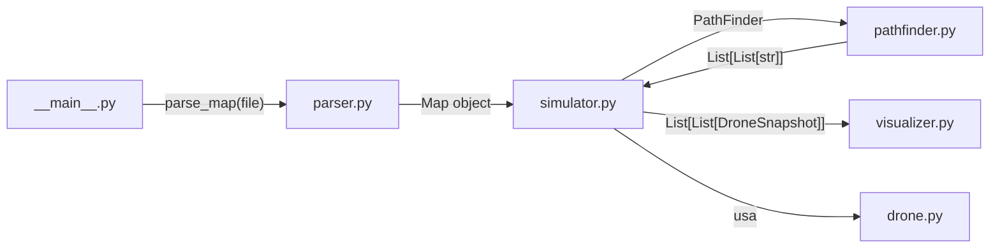
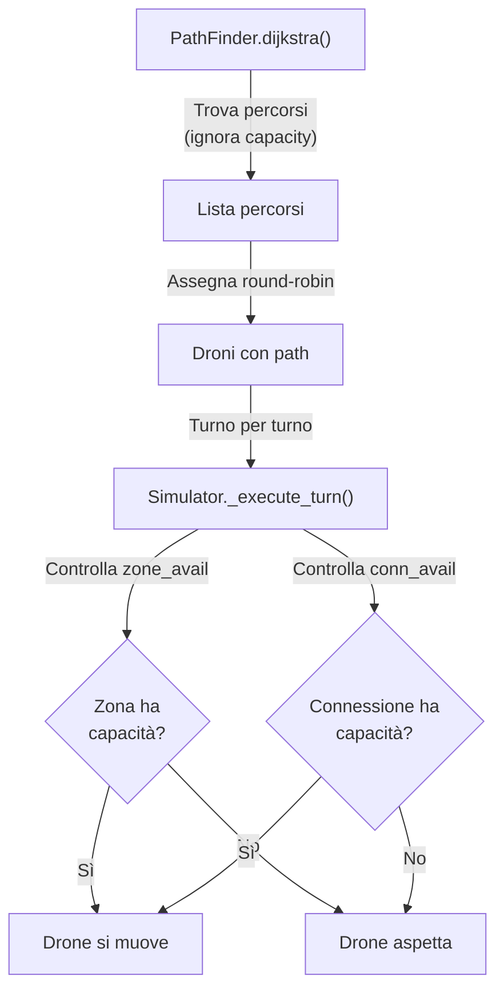

# 🛩️ Fly-In — Walkthrough Completo per la Correzione 42 (v2)

## Indice

1. [Panoramica Generale](#1-panoramica-generale)
2. [Architettura e Flusso Dati](#2-architettura-e-flusso-dati)
3. [Module: `__main__.py` — Entry Point](#3-module-__main__py--entry-point)
4. [Module: `parser.py` — Parsing della Mappa](#4-module-parserpy--parsing-della-mappa)
5. [Module: `drone.py` — Entità Drone](#5-module-dronepy--entità-drone)
6. [Module: `pathfinder.py` — Algoritmo Dijkstra (APPROFONDITO)](#6-module-pathfinderpy--algoritmo-dijkstra)
7. [Module: `simulator.py` — Motore di Simulazione (APPROFONDITO)](#7-module-simulatorpy--motore-di-simulazione)
8. [Module: `visualizer.py` — Rendering Pygame](#8-module-visualizerpy--rendering-pygame)
9. [Complessità Algoritmica e Trade-off](#9-complessità-algoritmica-e-trade-off)
10. [Risposte alle Domande della Evaluation Sheet](#10-risposte-alle-domande-della-evaluation-sheet)
11. [Live Coding: `--capacity-info`](#11-live-coding---capacity-info)

---

## 1. Panoramica Generale

**Fly-In** è una simulazione turn-based di droni che navigano da un `start_hub` a un `end_hub` in un grafo di zone, rispettando:

- **Capacità delle zone** (`max_drones`, default 1; illimitata per start/end)
- **Capacità delle connessioni** (`max_link_capacity`, default 1)
- **Tipi di zona** che determinano il costo di movimento:
  - `normal` → 1 turno
  - `priority` → 1 turno (ma preferita dal pathfinding, peso 0.9)
  - `restricted` → 2 turni (il drone "vola" per un turno sulla connessione, poi atterra)
  - `blocked` → inaccessibile (esclusa dal grafo)

> [!IMPORTANT]
> Il progetto NON usa librerie esterne per grafi (networkx, graphlib, ecc.). Tutto è implementato a mano con dizionari Python e `heapq`.

---

## 2. Architettura e Flusso Dati



**Flusso completo:**
1. `__main__.py` riceve il file mappa da CLI
2. `parser.py` legge il file → produce un oggetto `Map` (zone, connessioni, nb_drones)
3. `simulator.py` crea un `PathFinder` → trova i percorsi → assegna i percorsi ai droni → esegue turno per turno → registra snapshot
4. `visualizer.py` riceve `Map` + lista di snapshot → anima con Pygame

---

## 3. Module: `__main__.py` — Entry Point

📄 [__main__.py](file:///home/io/Desktop/fly-in/fly_in/__main__.py) — 44 righe

### Riga per riga:

| Righe | Cosa fa |
|-------|---------|
| 1–6 | Import: `argparse`, `sys`, più `ParseError`/`parse_map` dal parser, `Simulator`, `Visualizer` |
| 9–10 | Definisce `main()` con docstring |
| 11–23 | Blocco `try` principale: crea `ArgumentParser` con argomento posizionale `map_file` (riga 15), chiama `parse_map` (riga 18), crea `Simulator` e chiama `record()` (righe 20–21), crea `Visualizer` e lo lancia (righe 22–23) |
| 25–39 | Catena di `except`: `ArgumentError` (riga 25), `ParseError` (riga 28), `FileNotFoundError` (riga 31), `PermissionError`/`IsADirectoryError` (riga 34), `RuntimeError` (riga 37). Tutti stampano errore rosso (ANSI `\033[91m`) e fanno `sys.exit(1)` |
| 42–43 | Guard `if __name__ == "__main__"` per permettere `python -m fly_in` |

> [!NOTE]
> La differenza tra `simulator.run()` e `simulator.record()`: `run()` esegue e stampa soltanto, `record()` esegue, stampa E restituisce la lista di snapshot per il visualizer. `__main__` usa `record()`.

---

## 4. Module: `parser.py` — Parsing della Mappa

📄 [parser.py](file:///home/io/Desktop/fly-in/fly_in/parser.py) — 299 righe

### 4.1 Classi Dati

#### [`ParseError`](file:///home/io/Desktop/fly-in/fly_in/parser.py#L11-L14)
Eccezione custom, ereditata da `Exception`. Usata per segnalare qualunque errore di parsing.

#### [`Zone`](file:///home/io/Desktop/fly-in/fly_in/parser.py#L17-L36)
Rappresenta una zona del grafo:
- `name`: nome univoco (es. `"start"`, `"junction"`)
- `x`, `y`: coordinate intere per la visualizzazione
- `zone_type`: `"normal"` | `"blocked"` | `"restricted"` | `"priority"`
- `color`: colore opzionale (es. `"green"`)
- `max_drones`: capacità massima (default 1, -1 = illimitata per start/end)
- `is_start`, `is_end`: flag booleani

#### [`Connection`](file:///home/io/Desktop/fly-in/fly_in/parser.py#L39-L43)
Rappresenta un collegamento bidirezionale tra due zone:
- `zone1`, `zone2`: nomi delle zone
- `max_link_capacity`: quanti droni possono attraversarla contemporaneamente (default 1)

#### [`Map`](file:///home/io/Desktop/fly-in/fly_in/parser.py#L46-L52)

Contenitore principale:
- `nb_drones`: numero di droni da simulare
- `zones`: `Dict[str, Zone]` — dizionario nome → oggetto Zone
- `connections`: `List[Connection]` — lista di tutte le connessioni
- `start_zone`, `end_zone`: nomi della zona di partenza e arrivo

> [!IMPORTANT]
> **Perché la chiave del dizionario `zones` è il nome?**
>
> Perché il nome è l'**identificativo univoco** di ogni zona nel progetto. Le connessioni nel file mappa si riferiscono alle zone tramite nome (es. `connection: start-junction`), non tramite coordinate o indici. Usando il nome come chiave:
> 1. **Lookup O(1)**: quando il parser trova `connection: start-junction`, può verificare istantaneamente se "start" e "junction" esistono con `map_obj.zones["start"]`
> 2. **Lookup dal pathfinder**: la lista di adiacenza usa nomi come chiave → per ottenere le proprietà di una zona (tipo, capacità), basta fare `self.map.zones[nome]`
> 3. **Lookup dal simulator**: per verificare capacità, zona di arrivo, tipo, ecc.
> 4. **Unicità garantita**: il parser rifiuta nomi duplicati (riga 135–136), quindi la chiave è sempre univoca
>
> Alternative scartate:
> - Coordinate `(x, y)` come chiave? Sarebbero scomode da usare nelle connessioni che si riferiscono per nome
> - Indice intero? Richiederebbe una mappa nome→indice separata, aggiungendo complessità senza beneficio

### 4.2 Funzione [`parse_metadata`](file:///home/io/Desktop/fly-in/fly_in/parser.py#L55-L69)

Parsa stringhe tipo `"color=green max_drones=2"` (contenuto tra `[]`) e restituisce un dizionario `{"color": "green", "max_drones": "2"}`.

- **Split** per spazi → token
- Ogni token deve contenere `=` con chiave e valore non vuoti
- Se la sintassi è sbagliata → `ParseError`

### 4.3 Funzione [`_parse_zone`](file:///home/io/Desktop/fly-in/fly_in/parser.py#L72-L163)

Parsa una singola riga di zona (es. `hub: junction 1 0 [color=yellow max_drones=2]`):

| Righe | Cosa fa |
|-------|---------|
| 82–83 | Converte `x_str`, `y_str` in interi |
| 85–90 | **Coordinate duplicate**: controlla che `(x, y)` non sia già usato da un'altra zona |
| 92–94 | Valori default: `zone_type="normal"`, `color=None`, `max_drones=1` |
| 96–106 | Parsa metadata opzionale: valida che le chiavi siano solo `zone`, `color`, `max_drones` |
| 108–114 | Valida il tipo di zona (`normal`, `blocked`, `restricted`, `priority`) |
| 116–122 | Valida il colore: deve essere una stringa puramente alfabetica (`isalpha()`) |
| 124–133 | Valida che `max_drones` sia un intero positivo |
| 135–136 | **Nomi duplicati**: controlla che il nome non sia già presente |
| 138–149 | Se è `start_hub`: rifiuta se `blocked` (riga 142), controlla che non ce ne sia già uno (riga 145), setta il flag nel `Map`, forza `max_drones=-1` (illimitata) |
| 151–159 | Se è `end_hub`: stessa logica di start_hub |
| 161–163 | Crea l'oggetto `Zone` e lo aggiunge a `map_obj.zones` |

### 4.4 Funzione [`_parse_conn`](file:///home/io/Desktop/fly-in/fly_in/parser.py#L166-L215)

Parsa una singola riga di connessione (es. `connection: start-junction [max_link_capacity=2]`):

| Righe | Cosa fa |
|-------|---------|
| 174–176 | **Self-connection**: rifiuta connessioni `A-A` |
| 178–183 | Verifica che entrambe le zone esistano nel `Map` |
| 185–189 | **Duplicati**: ordina la coppia `(z1, z2)` e controlla nel set `seen_conns` |
| 191–213 | Parsa metadata: valida chiave `max_link_capacity`, deve essere intero positivo |
| 215 | Crea `Connection` e la aggiunge a `map_obj.connections` |

### 4.5 Funzione principale [`parse_map`](file:///home/io/Desktop/fly-in/fly_in/parser.py#L218-L298)

Orchestratore principale del parsing:

| Righe | Cosa fa |
|-------|---------|
| 219–220 | Apre il file e legge tutte le righe |
| 227–233 | **Due regex** precompilate: `zone_regex` per zone, `conn_regex` per connessioni |
| 227–229 | `zone_regex`: cattura `(start_hub\|end_hub\|hub)`, nome (no spazi/trattini), x, y, e opzionalmente metadata tra `[]` |
| 231–233 | `conn_regex`: cattura i due nomi delle zone separati da `-`, e opzionalmente metadata tra `[]` |
| 235–242 | Loop su ogni riga: rimuove commenti (tutto dopo `#`), strip whitespace, salta righe vuote |
| 244–262 | **Prima riga non-vuota DEVE essere `nb_drones: N`**: usa regex `^nb_drones:\s*([1-9]\d*)\s*$` (accetta solo interi positivi). Se la riga inizia con `nb_drones:` ma ha valore invalido → errore specifico; altrimenti → errore "first line must be nb_drones" |
| 266–290 | Per ogni riga successiva: prova il match come zona, poi come connessione, altrimenti errore di sintassi |
| 292–296 | **Validazione finale**: il file deve avere `nb_drones`, e deve avere esattamente un `start_hub` e un `end_hub` |

### 4.6 Le Regex Spiegate

#### `zone_regex` (riga 227–229):
```
^(start_hub|end_hub|hub):\s+([^\s\-]+)\s+(-?\d+)\s+(-?\d+)(?:\s*\[([^\[\]]*)\])?\s*$
```
| Pezzo | Significato |
|-------|-------------|
| `^(start_hub\|end_hub\|hub):` | Tipo di zona all'inizio riga |
| `\s+` | Almeno uno spazio |
| `([^\s\-]+)` | Nome della zona (niente spazi né trattini) |
| `\s+(-?\d+)\s+(-?\d+)` | Coordinate x e y (possono essere negative) |
| `(?:\s*\[([^\[\]]*)\])?` | Metadata opzionale tra `[` e `]` |
| `\s*$` | Fine riga con eventuali spazi finali |

#### `conn_regex` (riga 231–233):
```
^connection:\s+([^\s\-]+)-([^\s\-]+)(?:\s*\[([^\[\]]*)\])?\s*$
```
I nomi delle zone sono separati da `-`. I nomi stessi non possono contenere `-` (per evitare ambiguità nel parsing).

---

## 5. Module: `drone.py` — Entità Drone

📄 [drone.py](file:///home/io/Desktop/fly-in/fly_in/drone.py) — 51 righe

Classe semplice che rappresenta un singolo drone:

### Attributi (inizializzati in [`__init__`](file:///home/io/Desktop/fly-in/fly_in/drone.py#L18-L31)):
- `id`: identificativo 1-indexed (D1, D2, ...)
- `path`: lista di nomi di zone dal percorso assegnato (es. `["start", "junction", "goal"]`)
- `path_index`: indice corrente nel path (inizia a 0 = prima zona = start)
- `in_flight`: `True` quando il drone è "in volo" su una connessione verso una zona restricted
- `flight_from`, `flight_to`: zone sorgente e destinazione del volo
- `delivered`: `True` quando ha raggiunto la zona finale

### Properties:
- [`current_zone`](file:///home/io/Desktop/fly-in/fly_in/drone.py#L33-L38): restituisce `self.path[self.path_index]`, o `None` se in volo o consegnato
- [`next_zone`](file:///home/io/Desktop/fly-in/fly_in/drone.py#L40-L45): restituisce `self.path[self.path_index + 1]`, o `None` se è all'ultimo nodo
- [`steps_remaining`](file:///home/io/Desktop/fly-in/fly_in/drone.py#L47-L50): `len(path) - 1 - path_index` — quanti passi mancano all'arrivo. Usato per **prioritizzare** i droni più vicini alla meta nel simulator

---

## 6. Module: `pathfinder.py` — Algoritmo Dijkstra

📄 [pathfinder.py](file:///home/io/Desktop/fly-in/fly_in/pathfinder.py) — 181 righe

> [!IMPORTANT]
> **Questa è la parte più critica della correzione.** Il correttore ti chiederà di spiegare l'algoritmo, la complessità, e i trade-off. Studia questa sezione a fondo.

### 6.1 Classe [`PathFinder`](file:///home/io/Desktop/fly-in/fly_in/pathfinder.py#L7-L19)

#### Costruttore ([`__init__`](file:///home/io/Desktop/fly-in/fly_in/pathfinder.py#L21-L30), righe 21–30):
Riceve il `Map` e costruisce immediatamente la lista di adiacenza chiamando `_build_adjacency()`.

### 6.2 [`_build_adjacency`](file:///home/io/Desktop/fly-in/fly_in/pathfinder.py#L32-L55) — Costruzione del Grafo

Costruisce il grafo come **dizionario di adiacenza** (adjacency list):

```python
# Risultato finale (esempio con mappa simple_fork):
{
    "start":   [("junction", 1.0)],
    "junction": [("start", 1.0), ("path_a", 1.0), ("path_b", 1.0)],
    "path_a":  [("junction", 1.0), ("goal", 1.0)],
    "path_b":  [("junction", 1.0), ("goal", 1.0)],
    "goal":    [("path_a", 1.0), ("path_b", 1.0)]
}
```

**Passo per passo (righe 40–55):**

1. **Riga 40–42**: Crea un dizionario con una lista vuota per ogni zona: `{ "start": [], "junction": [], ... }`
2. **Righe 43–53**: Per ogni connessione nel `Map`:
   - Recupera gli oggetti `Zone` per entrambe le zone
   - Calcola il peso per andare **verso z2** (`_zone_weight(z2_obj)`) — il peso dipende dal tipo della zona di DESTINAZIONE
   - Calcola il peso per andare **verso z1** (`_zone_weight(z1_obj)`)
   - Se il peso non è `None` (zona non `blocked`), aggiunge l'arco

> [!IMPORTANT]
> **Il peso dipende dalla zona di DESTINAZIONE, non dalla sorgente.** Questo perché il costo è "quanto costa *entrare* in quella zona". Andare da A verso B costa in base al tipo di B, non di A. Per la stessa connessione A-B, il costo A→B può essere diverso da B→A se le zone hanno tipi diversi.

### 6.3 [`_zone_weight`](file:///home/io/Desktop/fly-in/fly_in/pathfinder.py#L57-L73) — Pesi degli Archi

| Tipo zona | Peso | Logica |
|-----------|------|--------|
| `blocked` | `None` → arco non creato | Zona inaccessibile |
| `restricted` | `2.0` | Costa 2 turni entrarci (1 turno di volo + 1 di atterraggio) |
| `priority` | `0.9` | Costa 1 turno reale, ma il peso < 1.0 lo fa preferire |
| `normal` | `1.0` | Costo standard |

> [!IMPORTANT]
> **Perché il peso di `priority` è 0.9 e non un valore più basso?**
>
> La scelta di 0.9 è un **compromesso pratico**. Quello che conta è che sia **strettamente minore di 1.0**, così Dijkstra preferisce le zone priority rispetto alle zone normal *a parità di numero di passi*. Il valore esatto non cambia il comportamento funzionale: 0.9, 0.5, 0.1 produrrebbero tutti lo stesso risultato — Dijkstra sceglierebbe la strada con più zone priority.
>
> **Allora perché non 0.5 o 0.1?** Perché 0.9 è intenzionalmente "vicino a 1.0" per **non distorcere troppo i calcoli di costo**. Se usassimo 0.1, un percorso con 10 zone priority avrebbe costo 1.0, lo stesso di 1 zona normal. Questo potrebbe far preferire percorsi lunghissimi pieni di zone priority rispetto a percorsi corti con zone normal, il che non ha senso perché nella *simulazione reale* ogni zona costa comunque 1 turno. Il peso 0.9 dice a Dijkstra: "a parità di lunghezza, scegli la strada priority, ma non fare deviazioni assurde per trovarla".
>
> In termini formali: con peso 0.9, un percorso priority è preferito solo se il costo totale resta competitivo. Con peso 0.1, il pathfinder potrebbe fare percorsi 10× più lunghi pur di attraversare zone priority — pessimo per la simulazione.

---

### 6.4 ⭐ Algoritmo [`dijkstra`](file:///home/io/Desktop/fly-in/fly_in/pathfinder.py#L75-L129) — Spiegazione Dettagliata

#### Cos'è Dijkstra?

Dijkstra è un algoritmo per trovare il **cammino più corto** da un nodo sorgente a un nodo destinazione in un grafo con **pesi non-negativi**. La garanzia è: quando estrai un nodo dall'heap, hai trovato la distanza minima verso quel nodo.

#### Le strutture dati (righe 96–99):

```python
dist: Dict[str, float] = {start: 0.0}        # distanza minima nota da start ad ogni nodo
prev: Dict[str, Optional[str]] = {start: None} # predecessore nel cammino minimo
heap: List[Tuple[float, int, str]] = [(0.0, 0, start)]  # min-heap (priorità, counter, nodo)
counter: int = 0                               # tiebreaker per l'heap
```

- **`dist`**: tiene traccia della distanza minima trovata finora per ogni nodo visitato. Se un nodo non è in `dist`, la sua distanza è infinita.
- **`prev`**: per ogni nodo, memorizza "da chi sono arrivato?". Serve alla fine per ricostruire il percorso.
- **`heap`**: coda con priorità (min-heap). Il nodo con distanza minima viene estratto per primo.
- **`counter`**: un intero che cresce ad ogni push. Serve come **tiebreaker**.

> [!NOTE]
> **Perché serve il `counter` nel tuple dell'heap?**
>
> L'heap contiene tuple `(distanza, counter, nome_nodo)`. Python confronta le tuple elemento per elemento. Se due nodi hanno la **stessa distanza** (es. `(1.0, ?, "A")` e `(1.0, ?, "B")`), Python prova a confrontare il secondo elemento. Se ci fosse direttamente la stringa come secondo elemento, `(1.0, "A")` vs `(1.0, "B")` funzionerebbe (le stringhe si confrontano), ma concettualmente non è corretto dare priorità basata sull'ordine alfabetico. Il `counter` (un intero crescente) garantisce che, a parità di distanza, il nodo **inserito per primo** venga estratto per primo (comportamento FIFO), rendendo l'algoritmo deterministico e prevedibile.

#### Il loop principale (righe 101–117) — Passo per passo:

```python
while heap:                                        # (1) Finché ci sono nodi da esplorare
    d, _, u = heapq.heappop(heap)                  # (2) Estrai il nodo con distanza minima
    if u == end:                                   # (3) Se è la destinazione → FINITO
        break
    if d > dist.get(u, float("inf")):              # (4) LAZY DELETION: skip se obsoleto
        continue
    for neighbor, weight in self.adj.get(u, []):   # (5) Per ogni vicino di u
        if neighbor in excluded:                   # (6) Salta nodi esclusi
            continue
        new_dist = d + weight                      # (7) Calcola nuova distanza
        if new_dist < dist.get(neighbor, float("inf")):  # (8) Rilassamento
            dist[neighbor] = new_dist              # (9) Aggiorna distanza minima
            prev[neighbor] = u                     # (10) Aggiorna predecessore
            counter += 1
            heapq.heappush(heap, (new_dist, counter, neighbor))  # (11) Aggiungi all'heap
```

##### Lazy Deletion — Riga 105–106:

```python
if d > dist.get(u, float("inf")):
    continue
```

Questo è il meccanismo di **lazy deletion** (eliminazione pigra). Quando troviamo un percorso migliore verso un nodo, non rimuoviamo la vecchia entry dall'heap (sarebbe costoso, O(n)). Invece, inseriamo una NUOVA entry con la distanza minore. Quando estraiamo la vecchia entry, la sua distanza `d` sarà maggiore di quella corrente in `dist[u]`, quindi la scartiamo.

**Esempio**: supponiamo che inseriamo `(5.0, 1, "junction")` e poi troviamo un percorso migliore e inseriamo `(3.0, 4, "junction")`. L'heap contiene entrambe. Quando estraiamo `(3.0, 4, "junction")`, processiamo normalmente. Quando poi estraiamo `(5.0, 1, "junction")`, vediamo che `5.0 > dist["junction"]` (che è 3.0) → skip.

##### Rilassamento — Riga 111:

Il **rilassamento** (relaxation) è l'operazione fondamentale di Dijkstra: "ho trovato un percorso verso `neighbor` passando per `u`, che costa `new_dist`. È meglio di quello che conoscevo prima?"

```python
new_dist = d + weight
if new_dist < dist.get(neighbor, float("inf")):
```

Se `neighbor` non è mai stato visto, `dist.get(neighbor, float("inf"))` restituisce infinito, quindi qualsiasi percorso è un miglioramento. Se è già stato visto, aggiorniamo solo se troviamo un percorso più corto.

#### Ricostruzione del percorso (righe 119–129):

```python
if end not in prev:        # Se end non è mai stato raggiunto → nessun percorso
    return None

path: List[str] = []
node: Optional[str] = end
while node is not None:    # Segui la catena dei predecessori: end → ... → start
    path.append(node)
    node = prev.get(node)
path.reverse()             # Inverti: [end, ..., start] → [start, ..., end]
return path
```

---

### 6.5 ⭐ Esempio Concreto: Dijkstra sulla mappa `simple_fork`

Usiamo questa mappa:

```
                  path_a (1.0)
                /              \
start (1.0) → junction (1.0)    goal
                \              /
                  path_b (1.0)
```

Grafo di adiacenza:
```
start    → [(junction, 1.0)]
junction → [(start, 1.0), (path_a, 1.0), (path_b, 1.0)]
path_a   → [(junction, 1.0), (goal, 1.0)]
path_b   → [(junction, 1.0), (goal, 1.0)]
goal     → [(path_a, 1.0), (path_b, 1.0)]
```

**Esecuzione passo per passo di `dijkstra("start", "goal")`:**

#### Stato iniziale:
| dist | prev | heap |
|------|------|------|
| `{"start": 0.0}` | `{"start": None}` | `[(0.0, 0, "start")]` |

#### Iterazione 1: Pop `(0.0, 0, "start")`
- `u = "start"`, `d = 0.0`
- Non è `"goal"` → continua
- `d (0.0) == dist["start"] (0.0)` → NON è obsoleto
- Vicini: `[("junction", 1.0)]`
  - `new_dist = 0.0 + 1.0 = 1.0` < `inf` → **rilassamento!**
  - `dist["junction"] = 1.0`, `prev["junction"] = "start"`
  - Push `(1.0, 1, "junction")`

| dist | prev | heap |
|------|------|------|
| `{start: 0.0, junction: 1.0}` | `{start: None, junction: "start"}` | `[(1.0, 1, "junction")]` |

#### Iterazione 2: Pop `(1.0, 1, "junction")`
- `u = "junction"`, `d = 1.0`
- Non è `"goal"` → continua
- Vicini: `[("start", 1.0), ("path_a", 1.0), ("path_b", 1.0)]`
  - `"start"`: `new_dist = 1.0 + 1.0 = 2.0` > `dist["start"] = 0.0` → **no rilassamento** (percorso peggiore)
  - `"path_a"`: `new_dist = 1.0 + 1.0 = 2.0` < `inf` → **rilassamento!** `dist["path_a"] = 2.0`, `prev["path_a"] = "junction"`, push `(2.0, 2, "path_a")`
  - `"path_b"`: `new_dist = 1.0 + 1.0 = 2.0` < `inf` → **rilassamento!** `dist["path_b"] = 2.0`, `prev["path_b"] = "junction"`, push `(2.0, 3, "path_b")`

| dist | prev | heap |
|------|------|------|
| `{start: 0.0, junction: 1.0, path_a: 2.0, path_b: 2.0}` | `{..., path_a: "junction", path_b: "junction"}` | `[(2.0, 2, "path_a"), (2.0, 3, "path_b")]` |

#### Iterazione 3: Pop `(2.0, 2, "path_a")` — (counter 2 < 3, quindi path_a prima di path_b)
- `u = "path_a"`, `d = 2.0`
- Vicini: `[("junction", 1.0), ("goal", 1.0)]`
  - `"junction"`: `new_dist = 2.0 + 1.0 = 3.0` > `dist["junction"] = 1.0` → no rilassamento
  - `"goal"`: `new_dist = 2.0 + 1.0 = 3.0` < `inf` → **rilassamento!** `dist["goal"] = 3.0`, `prev["goal"] = "path_a"`, push `(3.0, 4, "goal")`

#### Iterazione 4: Pop `(2.0, 3, "path_b")`
- `u = "path_b"`, `d = 2.0`
- Vicini: `[("junction", 1.0), ("goal", 1.0)]`
  - `"goal"`: `new_dist = 2.0 + 1.0 = 3.0`. Ma `dist["goal"]` è già `3.0` → `3.0 < 3.0` è FALSE → **no rilassamento**

#### Iterazione 5: Pop `(3.0, 4, "goal")`
- `u = "goal"` → **TROVATO!** `break`

#### Ricostruzione:
```
prev = {start: None, junction: "start", path_a: "junction", path_b: "junction", goal: "path_a"}

node = "goal" → path = ["goal"]
node = prev["goal"] = "path_a" → path = ["goal", "path_a"]
node = prev["path_a"] = "junction" → path = ["goal", "path_a", "junction"]
node = prev["junction"] = "start" → path = ["goal", "path_a", "junction", "start"]
node = prev["start"] = None → STOP

reverse → ["start", "junction", "path_a", "goal"]  ✓
```

---

### 6.6 [`find_paths`](file:///home/io/Desktop/fly-in/fly_in/pathfinder.py#L131-L164) — Percorsi Alternativi

Questa è la strategia per gestire **più droni contemporaneamente** senza che si intasino tutti sulla stessa strada.

#### Algoritmo (righe 148–164):

```python
# 1. Trova il percorso più corto
shortest = self.dijkstra(start, end)  # → ["start", "junction", "path_a", "goal"]

# 2. Per ogni nodo INTERMEDIO (esclusi start e end):
for node in shortest[1:-1]:           # → ["junction", "path_a"]
    # Escludi quel nodo e ricalcola Dijkstra
    alt = self.dijkstra(start, end, excluded={node})
    if alt is not None and alt not in paths:
        paths.append(alt)

# 3. Ordina per costo e restituisci (max 10)
```

#### Esempio concreto con `simple_fork`:

**Percorso più corto**: `["start", "junction", "path_a", "goal"]` (costo 3.0)

**Nodi intermedi**: `["junction", "path_a"]`

1. **Escludi "junction"**: `dijkstra("start", "goal", excluded={"junction"})` → `None` (junction è l'unico collegamento da start, senza di esso non c'è percorso)

2. **Escludi "path_a"**: `dijkstra("start", "goal", excluded={"path_a"})` → `["start", "junction", "path_b", "goal"]` (costo 3.0) → **AGGIUNTO!**

**Risultato finale**: 2 percorsi di costo uguale:
- `["start", "junction", "path_a", "goal"]`
- `["start", "junction", "path_b", "goal"]`

> [!NOTE]
> **Perché escludere i nodi e non gli archi?** Escludere un nodo è più aggressivo: forza Dijkstra a trovare un percorso che non tocca affatto quel nodo, risultando in percorsi veramente diversi. Escludere un arco potrebbe dare un percorso che rivisita lo stesso nodo da un'altra direzione, il che non aiuta con la congestione.
>
> **Perché tenere solo percorsi con costo ≤ 2× il migliore?** Per evitare percorsi assurdamente lunghi. Se il percorso migliore costa 3, un percorso che costa 7 farebbe arrivare i droni molto più tardi, rallentando la simulazione.
>
> **Questo è l'algoritmo di Yen (K-shortest paths)?** No, è un'euristica più semplice. Yen esplora tutte le deviazioni possibili da ogni nodo del percorso, qui invece si escluse un nodo alla volta dal percorso più corto. Trade-off: potrebbe non trovare tutti i percorsi alternativi possibili, ma è più semplice da implementare e capire.

### 6.7 [`path_cost`](file:///home/io/Desktop/fly-in/fly_in/pathfinder.py#L166-L180)

Somma i pesi di ogni zona di destinazione lungo il percorso (esclude la prima zona, che è lo start):

```python
cost = 0.0
for zone_name in path[1:]:  # Salta la prima zona (start)
    cost += _zone_weight(zone)
# Per ["start", "junction", "path_a", "goal"]:
# cost = weight("junction") + weight("path_a") + weight("goal") = 1.0 + 1.0 + 1.0 = 3.0
```

---

## 7. Module: `simulator.py` — Motore di Simulazione

📄 [simulator.py](file:///home/io/Desktop/fly-in/fly_in/simulator.py) — 371 righe

### 7.1 [`DroneSnapshot`](file:///home/io/Desktop/fly-in/fly_in/simulator.py#L12-L20)

`NamedTuple` immutabile che cattura lo stato di un drone in un certo turno:
- `drone_id`, `zone` (o `None` se in volo), `in_flight`, `flight_from`, `flight_to`, `delivered`

Usato dal visualizer per interpolare le posizioni tra turni.

### 7.2 Classe [`Simulator`](file:///home/io/Desktop/fly-in/fly_in/simulator.py#L23-L371)

#### Costanti (riga 36–37):
- `UNLIMITED_CAPACITY = 999999` — capacità delle zone start/end
- `MAX_TURNS = 10000` — safety limit per evitare loop infiniti

#### Costruttore ([`__init__`](file:///home/io/Desktop/fly-in/fly_in/simulator.py#L39-L53)):
- **Riga 45**: Salva il `Map`
- **Riga 46**: Lista vuota di droni (verranno creati in `_assign_paths`)
- **Riga 47**: Contatore turni, inizia a 0
- **Righe 50–53**: Crea `_conn_map`: dizionario `frozenset({z1, z2}) → Connection` per lookup O(1) delle connessioni

> [!NOTE]
> **Perché `frozenset`?** Le connessioni sono bidirezionali: la connessione A-B è la stessa di B-A. `frozenset({"A", "B"}) == frozenset({"B", "A"})`, quindi possiamo cercare una connessione indipendentemente dall'ordine in cui passiamo i nomi. Un semplice `tuple` non funzionerebbe perché `("A", "B") != ("B", "A")`.

#### [`_zone_capacity`](file:///home/io/Desktop/fly-in/fly_in/simulator.py#L71-L82):
Se `max_drones == -1` (start/end) → restituisce 999999, altrimenti il valore reale.

### 7.3 [`_assign_paths`](file:///home/io/Desktop/fly-in/fly_in/simulator.py#L84-L113) — Assegnazione Percorsi ai Droni

```
1. Crea PathFinder e trova i percorsi (find_paths)
2. Se nessun percorso → RuntimeError
3. Calcola il costo del percorso migliore (riga 96)
4. Filtra: tieni solo percorsi con costo ≤ 2× il migliore (righe 99–104)
5. Assegna in round-robin: drone i → percorso[i % len(percorsi)] (righe 107–108)
6. Caso limite: se start == end (path di lunghezza ≤ 1) → drone immediatamente delivered (righe 111–112)
```

**Esempio con 4 droni e 2 percorsi:**
| Drone | i | i % 2 | Percorso assegnato |
|-------|---|-------|-------------------|
| D1 | 0 | 0 | `["start", "junction", "path_a", "goal"]` |
| D2 | 1 | 1 | `["start", "junction", "path_b", "goal"]` |
| D3 | 2 | 0 | `["start", "junction", "path_a", "goal"]` |
| D4 | 3 | 1 | `["start", "junction", "path_b", "goal"]` |

### 7.4 [`record`](file:///home/io/Desktop/fly-in/fly_in/simulator.py#L145-L177) (usato da `__main__`):

1. Assegna i percorsi (riga 151)
2. Cattura snapshot iniziale — turno 0, tutti allo start (righe 152–154)
3. Loop: finché non tutti `delivered` (riga 156):
   a. Incrementa turno (riga 157)
   b. Esegui `_execute_turn()` (riga 158)
   c. Stampa i movimenti (righe 160–166)
   d. Cattura snapshot (riga 168)
   e. Safety: se turno > 10000, abort (righe 169–174)
4. Stampa messaggio di completamento (riga 176)
5. Restituisci tutti gli snapshot (riga 177)

### 7.5 ⭐ [`_execute_turn`](file:///home/io/Desktop/fly-in/fly_in/simulator.py#L201-L294) — Il Cuore della Simulazione

Ogni turno si divide in **2 fasi**:

#### Inizializzazione capacità (righe 215–231):

**Capacità zone** (righe 215–221):
```python
zone_avail: Dict[str, int] = {}
for name, zone in self.map.zones.items():
    current = sum(1 for d in self.drones if d.current_zone == name)
    zone_avail[name] = self._zone_capacity(zone) - current
```
Per ogni zona, conta quanti droni ci sono attualmente e sottrai dalla capacità massima. Il risultato è il numero di **posti liberi**.

**Capacità connessioni** (righe 223–231):
```python
conn_avail: Dict[FrozenSet[str], int] = {}
for conn in self.map.connections:
    key = frozenset({conn.zone1, conn.zone2})
    in_flight = sum(1 for d in self.drones
                    if d.in_flight and frozenset({d.flight_from, d.flight_to}) == key)
    conn_avail[key] = conn.max_link_capacity - in_flight
```
Per ogni connessione, conta quanti droni sono in volo su di essa e sottrai dalla capacità massima.

> [!NOTE]
> Questi dizionari (`zone_avail`, `conn_avail`) vengono **modificati in-place** durante il turno man mano che i droni si muovono. Così ogni movimento successivo vede le capacità aggiornate.

#### Fase 1: Atterraggi Forzati (righe 233–256)

I droni in volo (`in_flight == True`) **DEVONO** atterrare. Non è opzionale.

```python
for drone in self.drones:
    if not drone.in_flight:
        continue
    dest = drone.flight_to
    conn_key = frozenset({drone.flight_from, drone.flight_to})

    drone.path_index += 1       # Avanza nel percorso
    drone.in_flight = False      # Non è più in volo
    landed_ids.add(drone.id)     # Segna come "appena atterrato" (non può muoversi di nuovo)

    conn_avail[conn_key] += 1    # Libera la connessione
    zone_avail[dest] -= 1        # Occupa la zona di destinazione

    if dest == self.map.end_zone:
        drone.delivered = True   # Arrivato!

    moves.append((drone, dest))
```

> [!IMPORTANT]
> **Perché gli atterraggi avvengono PRIMA dei movimenti volontari?**
>
> 1. **Liberano capacità sulle connessioni**: se un drone atterra, la connessione su cui stava volando si libera, permettendo ad altri droni di usarla nello stesso turno
> 2. **La prenotazione della zona di destinazione era già avvenuta al turno precedente**: quando il drone è partito (in `_try_restricted_move`), la capacità della zona di arrivo è stata decrementata. Quindi il posto è già riservato — non c'è rischio di conflitto
> 3. **`landed_ids`** evita che un drone atterrato si muova di nuovo nello stesso turno

#### Fase 2: Movimenti Volontari (righe 258–293)

```python
# 1. Filtra i droni che possono muoversi (riga 260–266)
movable = [d for d in self.drones
           if not d.delivered           # Non è arrivato
           and not d.in_flight          # Non è in volo
           and d.id not in landed_ids   # Non è appena atterrato
           and d.path_index < len(d.path) - 1]  # Ha ancora passi da fare

# 2. Ordina: droni PIÙ VICINI alla meta si muovono per primi (riga 268)
movable.sort(key=lambda d: d.steps_remaining)

# 3. Per ogni drone, prova a muoversi (righe 270–292)
for drone in movable:
    curr = drone.current_zone
    next_z = drone.path[drone.path_index + 1]
    conn_key = frozenset({curr, next_z})

    if conn_avail.get(conn_key, 0) <= 0:   # Connessione piena? Aspetta.
        continue

    if zone_obj.zone_type == "restricted":
        self._try_restricted_move(...)      # Movimento in 2 turni
    else:
        self._try_normal_move(...)          # Movimento in 1 turno
```

> [!IMPORTANT]
> **Perché prioritizzare i droni più vicini alla meta?**
>
> È una **strategia greedy** per minimizzare la congestione. Un drone a 1 passo dalla fine, se si muove, libera la zona per un drone che è a 2 passi. Se fai il contrario:
> - Il drone lontano occupa la zona
> - Il drone vicino non può muoversi → un turno sprecato
> - Al turno dopo, il drone lontano va avanti, il drone vicino finalmente si muove
> - Risultato: 1 turno in più necessario
>
> Questo non è globalmente ottimale (per quello servirebbe programmazione lineare o simili), ma è un buon compromesso tra qualità e semplicità.

### 7.6 [`_try_normal_move`](file:///home/io/Desktop/fly-in/fly_in/simulator.py#L296-L329) — Movimento Immediato

```python
# Controlla che la zona di destinazione abbia capacità (riga 317)
if zone_avail.get(next_z, 0) <= 0:
    return  # Zona piena → non muoverti

# Esegui il movimento (righe 321–329)
zone_avail[curr] += 1      # Libera la zona corrente
zone_avail[next_z] -= 1    # Occupa la destinazione
conn_avail[conn_key] -= 1  # Consuma capacità connessione

drone.path_index += 1      # Avanza nel percorso
if next_z == self.map.end_zone:
    drone.delivered = True  # Arrivato!
```

### 7.7 [`_try_restricted_move`](file:///home/io/Desktop/fly-in/fly_in/simulator.py#L331-L370) — Movimento in 2 Turni

**Turno N** (questo metodo):
```python
# Controlla che la zona restricted di destinazione abbia capacità (riga 357)
if zone_avail.get(next_z, 0) <= 0:
    return  # Zona piena → non partire

# Esegui il volo (righe 361–370)
zone_avail[curr] += 1      # Libera la zona corrente
zone_avail[next_z] -= 1    # ⚠️ PRENOTA la destinazione!
conn_avail[conn_key] -= 1  # Consuma capacità connessione

drone.in_flight = True
drone.flight_from = curr
drone.flight_to = next_z
# NOTA: path_index NON avanza! Lo farà alla fase 1 del turno successivo
```

**Turno N+1** (fase 1, atterraggio forzato): il drone atterra automaticamente.

> [!WARNING]
> **La prenotazione (`zone_avail[next_z] -= 1`) è fondamentale.**
>
> Senza di essa: D1 e D2 partono entrambi verso la stessa zona restricted (max_drones=1). Al turno successivo, entrambi devono atterrare (fase 1, obbligatoria), ma c'è solo 1 posto → **deadlock irrisolvibile**.
>
> Con la prenotazione: D1 parte (prenota il posto). D2 prova a partire ma `zone_avail` è già 0 → non parte. Al turno successivo, D1 atterra. Il turno dopo, D2 può partire.

---

### 7.8 ⭐ Come la Capacity Influisce sull'Algoritmo

La capacity interviene in **due momenti distinti** del programma, e funziona in modo diverso in ciascuno:

#### A) Durante il Pathfinding (pathfinder.py) — La capacity NON viene considerata

Dijkstra **ignora completamente** le capacità di zone e connessioni. Non controlla `max_drones` né `max_link_capacity`. Cerca solo il percorso con peso minimo basandosi sui tipi di zona (normal=1.0, priority=0.9, restricted=2.0, blocked=escluso).

**Perché?** Perché Dijkstra calcola i percorsi *prima* della simulazione, quando non sa ancora quali zone saranno occupate e quando. La capacità è un vincolo *dinamico* (cambia turno per turno), mentre Dijkstra risolve un problema *statico* (il grafo non cambia).

> [!IMPORTANT]
> **Conseguenza pratica**: Dijkstra potrebbe assegnare a tutti i droni lo stesso percorso che passa per una zona con `max_drones=1`. Non è un problema, perché la **simulazione** si occuperà di far aspettare i droni in eccesso.

#### B) Durante la Simulazione (simulator.py) — La capacity è il vincolo principale

Ad ogni turno, `_execute_turn` **enforza** i vincoli di capacità:

1. **Calcola la capacità residua** di ogni zona e connessione (righe 215–231)
2. **Prima di ogni movimento**, controlla:
   - La **connessione** ha capacità? (`conn_avail[key] > 0`) — riga 280
   - La **zona di destinazione** ha capacità? (`zone_avail[next_z] > 0`) — riga 317 o 357
3. Se entrambe le condizioni sono soddisfatte → il drone si muove e le capacità vengono aggiornate
4. Se almeno una è violata → il drone **aspetta** (non si muove, riproverà al turno dopo)

Le capacità creano un **sistema di serializzazione naturale**: se un collo di bottiglia (bottleneck) ha capacità 1, i droni lo attraversano uno alla volta. Se ha capacità 2, a coppie. E così via.

#### Schema riassuntivo:



---

### 7.9 ⭐ Esempio Completo Passo-Passo: `maps/easy/02_simple_fork.txt`

#### Il file mappa

📄 [02_simple_fork.txt](file:///home/io/Desktop/fly-in/maps/easy/02_simple_fork.txt):

```txt
# Easy Level 2: Simple fork with two paths
nb_drones: 4

start_hub: start 0 0 [color=green]
hub: junction 1 0 [color=yellow max_drones=2]
hub: path_a 2 1 [color=blue]
hub: path_b 2 -1 [color=blue]
end_hub: goal 3 0 [color=red]

connection: start-junction [max_link_capacity=2]
connection: junction-path_a
connection: junction-path_b
connection: path_a-goal
connection: path_b-goal
```

#### Fase 1: Parsing — `parse_map("maps/easy/02_simple_fork.txt")`

Il parser produce questo oggetto `Map`:

| Campo | Valore |
|-------|--------|
| `nb_drones` | `4` |
| `start_zone` | `"start"` |
| `end_zone` | `"goal"` |

**Zone:**

| Nome | Tipo | Coordinate | max_drones | Colore | is_start | is_end |
|------|------|-----------|------------|--------|----------|--------|
| `start` | normal | (0,0) | **-1** (illimitata) | green | ✓ | |
| `junction` | normal | (1,0) | **2** | yellow | | |
| `path_a` | normal | (2,1) | **1** (default) | blue | | |
| `path_b` | normal | (2,-1) | **1** (default) | blue | | |
| `goal` | normal | (3,0) | **-1** (illimitata) | red | | ✓ |

**Connessioni:**

| Connessione | max_link_capacity |
|-------------|-------------------|
| `start-junction` | **2** |
| `junction-path_a` | **1** (default) |
| `junction-path_b` | **1** (default) |
| `path_a-goal` | **1** (default) |
| `path_b-goal` | **1** (default) |

> [!NOTE]
> Nota come `junction` ha `max_drones=2` (specificato nel file) e la connessione `start-junction` ha `max_link_capacity=2`. Tutte le altre hanno i **valori di default** (1). Questo significa che il collo di bottiglia (bottleneck) della mappa è `junction`: possono entrarci al massimo 2 droni alla volta.

#### Fase 2: Pathfinding — `PathFinder(map_obj).find_paths()`

##### 2a. Costruzione del grafo di adiacenza

Tutte le zone sono `normal` → tutti i pesi sono **1.0**:

```
start    → [("junction", 1.0)]
junction → [("start", 1.0), ("path_a", 1.0), ("path_b", 1.0)]
path_a   → [("junction", 1.0), ("goal", 1.0)]
path_b   → [("junction", 1.0), ("goal", 1.0)]
goal     → [("path_a", 1.0), ("path_b", 1.0)]
```

> La capacity (`max_drones`, `max_link_capacity`) **NON appare** nel grafo di adiacenza. Solo il tipo di zona determina i pesi.

##### 2b. Dijkstra trova il percorso più corto

`dijkstra("start", "goal")` → `["start", "junction", "path_a", "goal"]` (costo 3.0)

(Abbiamo già visto l'esecuzione passo-passo nella sezione 6.5)

##### 2c. Ricerca percorsi alternativi

Nodi intermedi del percorso: `["junction", "path_a"]`

1. **Escludi `"junction"`**: `dijkstra("start", "goal", excluded={"junction"})` → `None`
   - `junction` è l'unico collegamento da `start` → senza di esso il grafo è disconnesso
2. **Escludi `"path_a"`**: `dijkstra("start", "goal", excluded={"path_a"})` → `["start", "junction", "path_b", "goal"]` (costo 3.0)
   - Questo percorso è diverso dal primo → **aggiunto!**

**Risultato `find_paths()`**: 2 percorsi, entrambi di costo 3.0:
- Percorso 0: `["start", "junction", "path_a", "goal"]`
- Percorso 1: `["start", "junction", "path_b", "goal"]`

##### 2d. Filtro costi

`best_cost = 3.0`. Soglia: `3.0 × 2.0 = 6.0`. Entrambi i percorsi hanno costo 3.0 ≤ 6.0 → **entrambi accettati**.

#### Fase 3: Assegnazione Percorsi — `_assign_paths()`

4 droni, 2 percorsi, round-robin (`i % 2`):

| Drone | `i` | `i % 2` | Percorso assegnato | `steps_remaining` iniziale |
|-------|-----|---------|-------------------|---------------------------|
| D1 | 0 | 0 | `start → junction → path_a → goal` | 3 |
| D2 | 1 | 1 | `start → junction → path_b → goal` | 3 |
| D3 | 2 | 0 | `start → junction → path_a → goal` | 3 |
| D4 | 3 | 1 | `start → junction → path_b → goal` | 3 |

> [!TIP]
> D1 e D3 hanno lo **stesso percorso** (via `path_a`), e D2 e D4 hanno lo **stesso percorso** (via `path_b`). Questo è perfetto: le coppie condividono il percorso ma vengono serializzate dalla capacità delle zone (`path_a` e `path_b` hanno `max_drones=1`).

#### Fase 4: Simulazione Turno per Turno — `record()`

---

##### Turno 0 — Stato Iniziale (snapshot 0)

Tutti i droni sono in `start` (`path_index=0`).

**Capacità iniziali:**

| Zona | max_drones | Droni presenti | `zone_avail` |
|------|-----------|----------------|-------------|
| `start` | ∞ (999999) | 4 | 999995 |
| `junction` | 2 | 0 | **2** |
| `path_a` | 1 | 0 | **1** |
| `path_b` | 1 | 0 | **1** |
| `goal` | ∞ (999999) | 0 | 999999 |

| Connessione | max_link_capacity | In volo | `conn_avail` |
|-------------|-------------------|---------|-------------|
| `start-junction` | 2 | 0 | **2** |
| `junction-path_a` | 1 | 0 | **1** |
| `junction-path_b` | 1 | 0 | **1** |
| `path_a-goal` | 1 | 0 | **1** |
| `path_b-goal` | 1 | 0 | **1** |

---

##### Turno 1

**Fase 1** — Nessun drone in volo → niente da fare.

**Fase 2** — Movimenti volontari:

Droni movibili: D1, D2, D3, D4 (tutti `steps_remaining=3`).
Ordinamento: a parità di `steps_remaining`, l'ordine è quello di creazione (D1, D2, D3, D4).

| Drone | Vuole | `conn_avail` prima | `zone_avail` prima | Risultato | Aggiornamento |
|-------|-------|-------------------|--------------------|-----------|---------------|
| D1 | `start → junction` | `{start,junction} = 2` ✅ | `junction = 2` ✅ | **MUOVE** | `zone_avail[start] += 1`, `zone_avail[junction] = 1`, `conn_avail = 1` |
| D2 | `start → junction` | `{start,junction} = 1` ✅ | `junction = 1` ✅ | **MUOVE** | `zone_avail[start] += 1`, `zone_avail[junction] = 0`, `conn_avail = 0` |
| D3 | `start → junction` | `{start,junction} = 0` ❌ | — | **ASPETTA** | Connessione piena! |
| D4 | `start → junction` | `{start,junction} = 0` ❌ | — | **ASPETTA** | Connessione piena! |

> **D3 e D4 si bloccano alla connessione.** Anche se `junction` avesse avuto più posti, la connessione `start-junction` ha `max_link_capacity=2` e D1+D2 l'hanno esaurita. La connessione è il collo di bottiglia qui.

Output: **`Turn 1: D1-junction D2-junction`**

**Stato dopo turno 1:**

| Drone | Posizione | `path_index` | `steps_remaining` |
|-------|-----------|-------------|-------------------|
| D1 | `junction` | 1 | 2 |
| D2 | `junction` | 1 | 2 |
| D3 | `start` | 0 | 3 |
| D4 | `start` | 0 | 3 |

---

##### Turno 2

**Fase 1** — Nessun drone in volo → niente da fare.

**Capacità ricalcolate all'inizio del turno:**

| Zona | Droni presenti | `zone_avail` |
|------|----------------|-------------|
| `start` | 2 (D3, D4) | ∞ |
| `junction` | 2 (D1, D2) | **0** |
| `path_a` | 0 | **1** |
| `path_b` | 0 | **1** |
| `goal` | 0 | ∞ |

| Connessione | `conn_avail` |
|-------------|-------------|
| `start-junction` | **2** |
| `junction-path_a` | **1** |
| `junction-path_b` | **1** |
| `path_a-goal` | **1** |
| `path_b-goal` | **1** |

**Fase 2** — Ordinamento per `steps_remaining`:
- D1 (2 step), D2 (2 step) → **si muovono per primi**
- D3 (3 step), D4 (3 step) → dopo

| Drone | Vuole | `conn_avail` | `zone_avail` | Risultato | Aggiornamento |
|-------|-------|-------------|-------------|-----------|---------------|
| D1 | `junction → path_a` | `{junction,path_a} = 1` ✅ | `path_a = 1` ✅ | **MUOVE** | `zone_avail[junction] += 1 → 1`, `zone_avail[path_a] = 0`, `conn_avail = 0` |
| D2 | `junction → path_b` | `{junction,path_b} = 1` ✅ | `path_b = 1` ✅ | **MUOVE** | `zone_avail[junction] += 1 → 2`, `zone_avail[path_b] = 0`, `conn_avail = 0` |
| D3 | `start → junction` | `{start,junction} = 2` ✅ | `junction = 2` ✅ | **MUOVE** | `zone_avail[junction] = 1`, `conn_avail = 1` |
| D4 | `start → junction` | `{start,junction} = 1` ✅ | `junction = 1` ✅ | **MUOVE** | `zone_avail[junction] = 0`, `conn_avail = 0` |

> **Momento chiave:** D1 e D2 si muovono per primi (meno step rimanenti), liberando 2 posti in `junction`. Questo permette a D3 e D4 di entrare in `junction` nello **stesso turno**. Se D3/D4 si fossero mossi prima di D1/D2, `junction` sarebbe rimasta piena e avrebbero dovuto aspettare → **1 turno in più!** Ecco perché l'ordine di priorità conta.

Output: **`Turn 2: D1-path_a D2-path_b D3-junction D4-junction`**

**Stato dopo turno 2:**

| Drone | Posizione | `path_index` | `steps_remaining` |
|-------|-----------|-------------|-------------------|
| D1 | `path_a` | 2 | 1 |
| D2 | `path_b` | 2 | 1 |
| D3 | `junction` | 1 | 2 |
| D4 | `junction` | 1 | 2 |

---

##### Turno 3

**Capacità ricalcolate:**

| Zona | Droni presenti | `zone_avail` |
|------|----------------|-------------|
| `start` | 0 | ∞ |
| `junction` | 2 (D3, D4) | **0** |
| `path_a` | 1 (D1) | **0** |
| `path_b` | 1 (D2) | **0** |
| `goal` | 0 | ∞ |

**Fase 2** — Ordinamento:
- D1 (1 step), D2 (1 step) → **prima**
- D3 (2 step), D4 (2 step) → dopo

| Drone | Vuole | `conn_avail` | `zone_avail` | Risultato |
|-------|-------|-------------|-------------|-----------|
| D1 | `path_a → goal` | `{path_a,goal} = 1` ✅ | `goal = ∞` ✅ | **MUOVE → DELIVERED!** `zone_avail[path_a] += 1 → 1` |
| D2 | `path_b → goal` | `{path_b,goal} = 1` ✅ | `goal = ∞` ✅ | **MUOVE → DELIVERED!** `zone_avail[path_b] += 1 → 1` |
| D3 | `junction → path_a` | `{junction,path_a} = 1` ✅ | `path_a = 1` ✅ | **MUOVE** (il posto si è liberato grazie a D1!) |
| D4 | `junction → path_b` | `{junction,path_b} = 1` ✅ | `path_b = 1` ✅ | **MUOVE** (il posto si è liberato grazie a D2!) |

> **Di nuovo l'ordine è fondamentale:** D1 esce da `path_a` (libera il posto), poi D3 può entrarci nello stesso turno. Senza priorità, D3 avrebbe provato ad entrare in `path_a` ancora occupato da D1, fallendo.

Output: **`Turn 3: D1-goal D2-goal D3-path_a D4-path_b`**

---

##### Turno 4

**Fase 2:**

| Drone | Vuole | Risultato |
|-------|-------|-----------|
| D3 | `path_a → goal` | **MUOVE → DELIVERED!** |
| D4 | `path_b → goal` | **MUOVE → DELIVERED!** |

Output: **`Turn 4: D3-goal D4-goal`**

**✅ Simulazione completata: 4 turni.**

---

#### Cosa sarebbe cambiato con capacity diverse?

| Modifica | Effetto |
|----------|---------|
| `junction max_drones=1` (invece di 2) | Solo 1 drone alla volta in junction → i droni passano uno alla volta → **molti più turni** |
| `start-junction max_link_capacity=4` (invece di 2) | Tutti e 4 i droni potrebbero partire al turno 1, ma `junction` ha max=2 → **bloccati dalla zona**, non dalla connessione → stesso risultato |
| `start-junction max_link_capacity=1` (invece di 2) | Solo 1 drone alla volta sulla connessione → anche se junction ha posto, entra 1 per turno → **più turni** |
| `path_a max_drones=2` e `path_b max_drones=2` | D1 e D3 potrebbero stare entrambi in `path_a` contemporaneamente → **possibile riduzione turni** (ma in questo caso non cambia perché il bottleneck è junction) |

> [!IMPORTANT]
> **In sintesi**: la capacity non cambia *quali* percorsi vengono trovati (Dijkstra la ignora), ma cambia *quanto velocemente* i droni riescono a percorrerli. Il numero finale di turni dipende dal **collo di bottiglia più stretto** della mappa — la zona o connessione con la capacità più bassa lungo i percorsi utilizzati.

---

## 8. Module: `visualizer.py` — Rendering Pygame

📄 [visualizer.py](file:///home/io/Desktop/fly-in/fly_in/visualizer.py) — 323 righe

### 8.1 Costanti (righe 11–46)

- Finestra: 1280×720 a 60 FPS
- Padding: 100px per lato
- Cerchi zona: raggio 20px con outline di 2px
- Palette di colori pastello predefiniti (`PASTEL_COLORS`)
- Il simbolo del drone è **✇** (Unicode), renderizzato con font di sistema

### 8.2 Costruttore ([`__init__`](file:///home/io/Desktop/fly-in/fly_in/visualizer.py#L55-L74))

1. Salva `Map` e `snapshots` (righe 61–62)
2. Calcola le posizioni pixel di ogni zona (`_compute_positions`) (riga 63–65)
3. Inizializza Pygame e pre-renderizza il carattere drone ✇ come surface (righe 68–74)

### 8.3 [`_compute_positions`](file:///home/io/Desktop/fly-in/fly_in/visualizer.py#L78-L105) — Trasformazione Coordinate

Trasforma coordinate logiche (dal file mappa) in pixel:

```
1. Trova min/max di tutte le coordinate x e y (righe 81–85)
2. Calcola lo spazio utilizzabile: finestra - 2×padding (righe 87–88)
3. Gestisci il caso range=0: se tutte le zone hanno la stessa x (o y), range = 1 (righe 90–91)
4. Calcola la scala: min(spazio_x/range_x, spazio_y/range_y) per mantenere l'aspect ratio (riga 93)
5. Centra il grafo nello spazio utilizzabile (righe 95–98)
6. Per ogni zona (righe 101–104):
   px = offset + (x - min_x) × scala
   py = offset + (max_y - y) × scala  ← Y invertito!
```

> [!NOTE]
> L'asse Y è invertito (`max_y - zone.y`) perché nei sistemi grafici (Pygame, browser, ecc.) l'asse Y cresce verso il basso (0 in alto), ma nelle coordinate logiche del file l'asse Y cresce verso l'alto (come nella matematica classica).

### 8.4 [`_resolve_color`](file:///home/io/Desktop/fly-in/fly_in/visualizer.py#L109-L126) — Risoluzione Colore

1. Se la zona ha un colore nel `PASTEL_COLORS` predefinito → usa quello
2. Altrimenti, prova a parsarlo come `pygame.Color` e lo "pastelizza" mescolandolo col bianco: `(r+255)//2`
3. Se fallisce → fallback a `DEFAULT_ZONE_COLOR` (verde pastello chiaro)

### 8.5 [`_get_drone_pos`](file:///home/io/Desktop/fly-in/fly_in/visualizer.py#L136-L165) — Interpolazione

Interpola linearmente la posizione di un drone tra due snapshot:

```
1. Calcola posizione SORGENTE (righe 144–151):
   - Se il drone era in volo → punto medio della connessione (midpoint)
   - Se era su una zona → posizione pixel della zona
   - Se era delivered → posizione della zona finale

2. Calcola posizione DESTINAZIONE (righe 154–161): stessa logica

3. Interpolazione lineare (righe 163–165):
   x = src_x + (dst_x - src_x) × t
   y = src_y + (dst_y - src_y) × t
   dove t ∈ [0, 1] è frame_in_turn / 60
```

Quando `t=0` il drone è alla posizione sorgente, quando `t=1` è alla destinazione. Nei frame intermedi si muove linearmente → animazione fluida a 60 FPS.

### 8.6 [`_draw_drones_and_counts`](file:///home/io/Desktop/fly-in/fly_in/visualizer.py#L201-L238)

Per ogni drone (righe 212–229):
- Se è **fermo** (non in_flight in entrambi gli snapshot, stessa zona, zona non None) → incrementa `zone_counts[zona]`
- Se si sta **muovendo** → disegna il simbolo ✇ alla posizione interpolata

Poi (righe 232–238): per ogni zona con `count > 0`, disegna il numero centrato dentro il cerchio della zona.

> [!NOTE]
> I droni fermi non vengono disegnati come simbolo ✇ individuale. Vengono mostrati come un **numero** dentro la zona. Es. "3" dentro il cerchio significa 3 droni fermi lì. Questo evita di sovrapporre simboli e rende la visualizzazione leggibile.

### 8.7 Main Loop ([`run`](file:///home/io/Desktop/fly-in/fly_in/visualizer.py#L259-L322))

```
1. Inizializza Pygame, finestra 1280×720 (righe 261–263)
2. Crea font per label, HUD, e contatori (righe 265–269)
3. Loop a 60 FPS (righe 278–319):
   a. Gestisci eventi: solo QUIT (righe 282–284)
   b. Avanza playback: ogni 60 frame (= 1 secondo) → passa allo snapshot successivo (righe 287–294)
   c. Calcola t = frame_in_turn / 60 (riga 296)
   d. Determina prev_states e curr_states per l'interpolazione (righe 299–308)
   e. Disegna: sfondo bianco → connessioni → zone → droni → HUD (righe 311–317)
   f. pygame.display.flip() per aggiornare lo schermo (riga 319)
4. Alla chiusura → pygame.quit() e sys.exit() (righe 321–322)
```

---

## 9. Complessità Algoritmica e Trade-off

### Complessità

| Componente | Complessità | Spiegazione |
|------------|-------------|-------------|
| **Dijkstra** | O((V + E) log V) | V = numero zone, E = numero connessioni. L'heap ha al massimo V elementi effettivi (con lazy deletion può contenere di più, ma ogni nodo viene processato al più una volta) |
| **find_paths** | O(V × (V + E) log V) | Esegue Dijkstra una volta per ogni nodo intermedio del percorso più corto (al massimo V-2 volte) |
| **_build_adjacency** | O(E) | Un passaggio su tutte le connessioni |
| **_execute_turn** | O(D × (D + V + E)) | D = numero droni. L'inizializzazione delle capacità è O(D×V) nel caso peggiore (per ogni zona, conta i droni presenti). L'ordinamento è O(D log D). Il loop sui droni movibili è O(D) |
| **Simulazione totale** | O(T × D × (D + V + E)) | T = numero turni |
| **Parsing** | O(L) | L = numero righe del file, ogni riga è processata con regex in O(lunghezza riga) |
| **Visualizzazione (per frame)** | O(V + E + D) | Disegna tutti i nodi, archi, e droni |

### Trade-off e Decisioni di Design

1. **Perché Dijkstra e non BFS?** BFS funziona solo con pesi uniformi (tutti = 1). Le zone `restricted` (peso 2.0) e `priority` (peso 0.9) richiedono pesi variabili → Dijkstra è necessario. BFS troverebbe il percorso con meno archi, non quello con costo minimo.

2. **Perché escludere nodi intermedi per percorsi alternativi?** È un'euristica semplice (non è l'algoritmo di Yen per i K-shortest paths). Trade-off: potrebbe non trovare tutti i percorsi alternativi possibili (es. percorsi che condividono nodi con il più corto), ma è molto più semplice da implementare, capire, e spiegare alla correzione.

3. **Perché round-robin per l'assegnazione?** Distribuisce equamente i droni sui percorsi disponibili, evitando di sovraccaricare un singolo percorso. Alternativa scartata: assegnare in base alla capacità dei percorsi → più complesso e marginale miglioramento.

4. **Perché prioritizzare droni più vicini alla meta?** Strategia greedy: i droni che finiscono prima liberano risorse per gli altri. Non è globalmente ottimale (per quello servirebbe ottimizzazione combinatoria), ma è un buon compromesso tra qualità della soluzione e semplicità di implementazione.

5. **Perché la prenotazione per zone restricted?** Senza prenotazione, due droni potrebbero entrambi iniziare il volo verso la stessa zona restricted con capacità 1, causando un deadlock al turno successivo. La prenotazione garantisce che i vincoli di capacità non vengano mai violati.

---

## 10. Risposte alle Domande della Evaluation Sheet

### "Come funziona il tuo grafo?"
> Il grafo è implementato come una **lista di adiacenza** usando un dizionario Python: `Dict[str, List[Tuple[str, float]]]`. Ogni zona mappa a una lista di `(vicino, peso)`. Le connessioni sono bidirezionali: per ogni connessione A-B, aggiungo sia A→B che B→A, ognuno con il peso della zona di **destinazione**. Le zone `blocked` sono escluse non creando gli archi verso di esse. La scelta della lista di adiacenza (rispetto alla matrice) è dovuta al fatto che i grafi delle mappe sono **sparsi** (poche connessioni rispetto al numero di zone al quadrato).

### "Come funziona il tuo pathfinding?"
> Uso l'algoritmo di Dijkstra con un **min-heap** (`heapq`). Dijkstra funziona perché tutti i pesi sono non-negativi (0.9, 1.0, 2.0). I pesi degli archi dipendono dal tipo della zona di **destinazione**: normal=1.0, priority=0.9 (per farla preferire a parità di percorso), restricted=2.0, blocked=escluso. Per trovare percorsi alternativi, escludo uno alla volta i nodi intermedi del percorso più corto e rieseguo Dijkstra. Tengo solo percorsi con costo ≤ 2× il migliore e li assegno ai droni in round-robin.

### "Come gestisci la capacità?"
> Ad ogni turno, calcolo la capacità residua di ogni zona (`zone_avail`) e connessione (`conn_avail`) come dizionari. I movimenti aggiornano questi contatori **in-place**: quando un drone lascia una zona, la capacità aumenta di 1; quando entra, diminuisce di 1. Per le zone restricted, prenoto la capacità al momento della partenza (decremento `zone_avail` della destinazione) per evitare conflitti al turno successivo.

### "Come gestisci i conflitti tra droni?"
> Tre meccanismi: **(1) Ordine di priorità**: i droni più vicini alla meta si muovono per primi (`sort` per `steps_remaining`), liberando risorse per gli altri. **(2) Verifica capacità prima del movimento**: se una zona o connessione è piena, il drone aspetta al prossimo turno. **(3) Due fasi per turno**: prima atterraggio forzato dei droni in volo (che libera connessioni), poi movimenti volontari. Questo schema impedisce violazioni di capacità e deadlock.

### "Qual è la complessità del tuo algoritmo?"
> Dijkstra è O((V+E) log V) per una singola ricerca. Il find_paths esegue Dijkstra fino a V volte (una per nodo intermedio), quindi è O(V(V+E) log V). La simulazione è O(T × D × (D+V+E)) dove T=turni, D=droni. In pratica, con le mappe del progetto (poche decine di zone e droni), è istantaneo.

---

## 11. Live Coding: `--capacity-info`

> [!CAUTION]
> Il correttore ti chiederà di aggiungere un flag `--capacity-info` che mostra informazioni sulla capacità ad ogni turno. Ecco il modo più semplice per implementarlo.

### Dove intervenire:

Servono modifiche a **2 file**: [`__main__.py`](file:///home/io/Desktop/fly-in/fly_in/__main__.py) e [`simulator.py`](file:///home/io/Desktop/fly-in/fly_in/simulator.py).

### Step 1: Aggiungere l'argomento in `__main__.py`

In [__main__.py](file:///home/io/Desktop/fly-in/fly_in/__main__.py), dopo la riga 15 (`add_argument("map_file", ...)`):

```python
arg_parser.add_argument(
    "--capacity-info", action="store_true",
    help="Display capacity info during simulation"
)
```

E passare il flag al simulator alla riga 20:

```python
simulator = Simulator(map_obj, capacity_info=args.capacity_info)
```

### Step 2: Modificare il `Simulator`

In [simulator.py](file:///home/io/Desktop/fly-in/fly_in/simulator.py):

**2a.** Aggiungere `capacity_info: bool = False` al costruttore `__init__` (riga 39):
```python
def __init__(self, map_obj: Map, capacity_info: bool = False) -> None:
    # ...codice esistente...
    self.capacity_info: bool = capacity_info
```

**2b.** In [`_execute_turn`](file:///home/io/Desktop/fly-in/fly_in/simulator.py#L201), alla **fine del metodo** (prima di `return moves`, riga 294), aggiungere:

```python
if self.capacity_info:
    for name, zone in self.map.zones.items():
        used = self._zone_capacity(zone) - zone_avail[name]
        cap = self._zone_capacity(zone)
        if cap < self.UNLIMITED_CAPACITY:
            print(f"  Zone {name}: {used}/{cap} drones")
    for conn in self.map.connections:
        key = frozenset({conn.zone1, conn.zone2})
        used = conn.max_link_capacity - conn_avail[key]
        print(f"  Connection {conn.zone1}-{conn.zone2}: "
              f"{used}/{conn.max_link_capacity} capacity used")
```

> [!TIP]
> **Perché questo approccio è il più semplice:** `zone_avail` e `conn_avail` sono già calcolati e aggiornati in `_execute_turn`. Basta stamparli alla fine del turno. Non serve creare nuove strutture dati o nuovi metodi.

### Esempio di output atteso:

```
Turn 1: D1-junction D2-junction
  Zone junction: 2/2 drones
  Zone dead_end: 0/1 drones
  Zone correct_path: 0/1 drones
  Zone intermediate: 0/1 drones
  Connection start-junction: 2/2 capacity used
  Connection junction-dead_end: 0/1 capacity used
  ...
```
